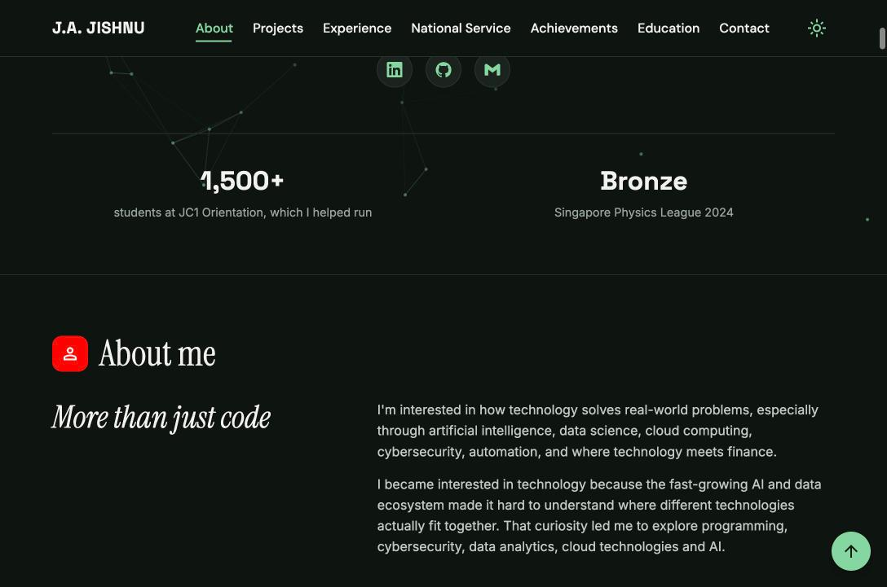
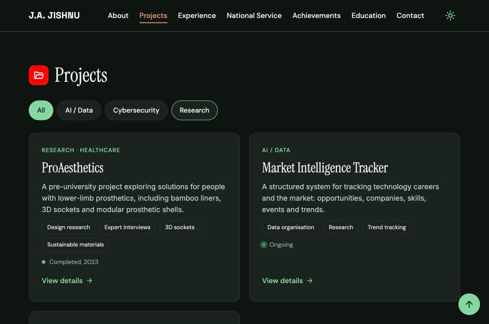
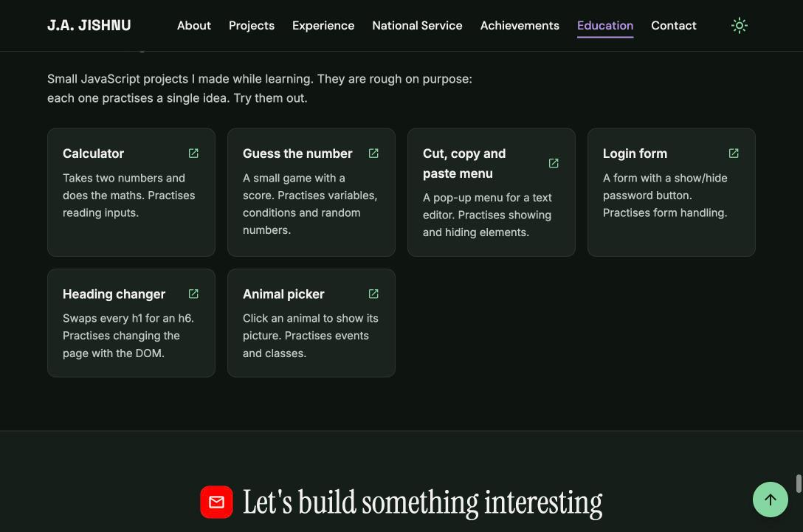
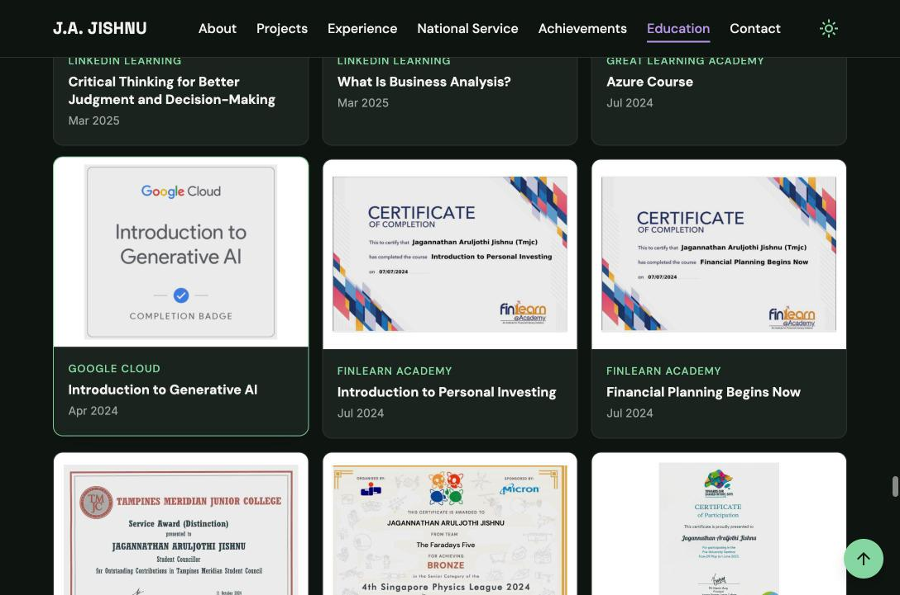

<h1 align="center">J.A. Jishnu — Portfolio</h1>

A personal portfolio built as a static site with no frameworks and no build step, hosted on <a href="https://vercel.com" target="_blank">Vercel</a>

## 🎬 Walkthrough

A quick tour of the site and the concepts behind each part.

### 🏠 Home

- **HTML:** semantic header and nav, a skip-to-content link, and a canvas element for the background
- **CSS:** custom properties for the colour theme, a scrolling marquee built with keyframes, and clamp for fluid headline sizes
- **JavaScript:** a canvas dot network drawn with requestAnimationFrame that reacts to the mouse, count-up numbers, and a dark/light toggle saved in localStorage

### 👤 About

- **HTML:** a section with article cards and data attributes
- **CSS:** CSS Grid for the four-card layout and a two-column layout that stacks on phones
- **JavaScript:** IntersectionObserver fades each item in as it scrolls into view, one after another

### 🚀 Projects

- **HTML:** each card carries data-category, data-demo and data-github attributes
- **CSS:** auto-fit grid, hover and focus-visible states, and the :has selector
- **JavaScript:** filter buttons show and hide cards, and a native dialog element opens the "View details" pop-up

### 🧪 Playground

- **HTML:** a list of cards linking to small projects I built while learning
- **CSS:** responsive grid that changes columns at each breakpoint
- **JavaScript:** each mini project practises one idea, such as events, the DOM, forms or random numbers

### 🏅 Certificates

- **HTML:** figure and figcaption elements with lazy-loaded images
- **CSS:** aspect-ratio and object-fit keep different certificates tidy
- **JavaScript:** category filters and a full-size dialog pop-up

## 📚 Concepts Applied

### 🧱 HTML

- **Semantic structure:** header, nav, main, section, article, figure and footer elements instead of generic divs
- **Accessibility:** skip-to-content link, image alt text, ARIA labels and tab roles
- **Pop-ups:** the native dialog element for project and certificate previews
- **Forms:** a labelled contact form
- **Data attributes:** cards store their own category, links and numbers for JavaScript to use
- **Performance:** lazy-loaded images
- **SEO and sharing:** meta description, Open Graph and Twitter card tags, favicon
- **Graphics:** inline SVG icons and a canvas for the hero animation

### 🎨 CSS

- **Custom properties:** about 60 variables for colours, fonts and spacing, which also power light and dark mode
- **Layout:** CSS Grid for card layouts and Flexbox for alignment
- **Responsive design:** mobile-first, with breakpoints for tablets and desktops
- **Fluid sizing:** clamp and calc so text and spacing scale with the screen
- **Animation:** keyframe animations, transitions and transforms
- **Modern selectors:** has, not, nth-child and focus-visible
- **Visual effects:** sticky navigation, blur backgrounds, gradients and masks
- **Accessibility:** animations switch off for visitors who prefer reduced motion

### ⚡ JavaScript

- **DOM manipulation:** selecting, creating and updating elements, classes and data attributes
- **Event handling:** click, keyboard, scroll, input, form submit and pointer events
- **Observers:** IntersectionObserver for scroll reveals and the active nav link, ResizeObserver for the canvas
- **Canvas animation:** a floating dot network that reacts to the mouse and pauses when off-screen
- **Performance:** requestAnimationFrame to throttle scrolling, fewer dots on phones
- **Storage:** dark mode choice saved in localStorage
- **Custom components:** keyboard-friendly tabs, project and certificate filters, count-up numbers and modal pop-ups
- **Form validation:** field-by-field error messages
- **Async:** a fetch request to show the résumé button only when the PDF exists
- **Defensive coding:** every feature checks its HTML exists before running
- **Modern syntax:** const and let, arrow functions, template literals and spread

## 🚀 Running Locally

1. Download or clone the repository
2. Open index.html in a browser

No install or build step is needed.
